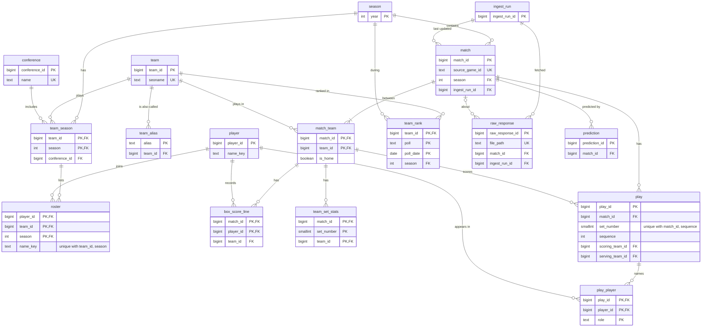

# Database Schema

**Status:** Proposed for review before W1-05 (initial migration)

This document describes the Postgres schema for Sideout Analytics: the tables,
how they relate, and the reasoning behind the design.

## Assumptions

- Data covers multiple seasons.
- Players transfer only between seasons, never during one.
- Time-phased stats (season to date, last N matches, conference only, and so
  on) are calculated at query time and cached. There are too many
  combinations to store them all. If specific leaderboards turn out to be slow,
  they can be precomputed later, for example as materialized views.
- The source API ([source-data-api-endpoints.md](source-data-api-endpoints.md))
  has no player IDs, always marks one team as home (even at neutral sites),
  has no neutral-site flag, and serves only the current week's rankings.
- Not every team is Division I. In the 2025 prototype data, 348 of 384 teams
  are; the rest are lower-division opponents.

## Decisions and tradeoffs

### 1. Stats are stored as rows; raw responses stay on disk

Box score and play-by-play data are parsed into `box_score_line`,
`team_set_stats`, `play`, and `play_player`. Raw API responses are saved as
files by the raw response cache (W1-08). The database stores only an index of
those files in `raw_response`.

- **Why rows:** leaderboards, team pages, and charts filter and aggregate
  stats across many matches. Postgres can index and aggregate columns, but not
  practically the contents of JSON blobs.
- **Why raw files on disk:** the raw data is already about 888 MB for one
  season. Storing it in Postgres would put it in every nightly backup (W3-06)
  and keep two copies of the same data that could drift apart.
- **Tradeoff:** the importer must parse every response. The files on disk let
  matches be re-parsed after parser fixes.

### 2. Every source count is stored; rates and totals are calculated

The importer stores every count the API provides, including ones no page uses
yet, such as sets played, set attempts, and blocking errors. Rates and totals
are calculated at query time: hitting percentage, sideout percentage, points,
total blocks, per-set averages, previous poll rank, team record, and a team's
final tournament round.

- **Why:** a stored total can disagree with the counts it came from. A
  calculated one can't. A dropped count can only be recovered by re-parsing
  every response.
- **Tradeoff:** queries do slightly more arithmetic.

### 3. Each stat has one source per level

The box score is the source of truth for match totals. Play-by-play adds the
set and rally level, and is used only when it reconciles with the box score.

| Stat | Match level | Set level |
| --- | --- | --- |
| Kills, attack errors, attack attempts | box score | API per-set stats |
| Points (set score) | API linescores | API linescores |
| Aces, serve errors, block points | box score | play-by-play, if reconciled |
| Serve attempts | box score | play-by-play, if reconciled |
| Sideouts, serve points | play-by-play, if reconciled | play-by-play, if reconciled |
| Digs, receptions, assists | box score | not available |

- **Why:** on a sample match (West Virginia vs Kansas St., 5 sets),
  play-by-play totals matched the box score exactly for kills, attack errors,
  aces, serve errors, and block points, and per-set kills matched the API's
  per-set stats. Play-by-play is the only source for sideouts and serve
  points.
- **Reconciliation:** after parsing, the importer sums play-by-play events per
  team and compares them with the box score. The result is stored in
  `match.pbp_reconciled`. If it fails, the play-by-play columns in
  `team_set_stats` are NULL.
- **Tradeoff:** a match with a messy feed loses its per-set serving and block
  stats entirely rather than showing numbers that don't add up. Digs are never
  available per set.

### 4. Per-set team stats are a stored table, not a view

`team_set_stats` is built by the importer.

- **Why:** combining three sources and gating on reconciliation is easier to
  write and test in Python than in SQL. Pages read it with a plain select.
- **Tradeoff:** it must be rebuilt when a match is re-imported. The importer
  deletes and rebuilds a match's rows, so re-runs are safe.

### 5. Each team's side of a match is its own row

`match_team` has one row per team per match: whether it was home, whether it
won, its score, seed, and rank at the time. `match` itself names no teams.
Stats tables (`box_score_line`, `team_set_stats`, `play`) reference
`match_team (match_id, team_id)`.

- **Why:** winner/loser columns can't describe scheduled or live matches, and
  every query for one team's stats would need a `CASE` on whether that team
  won. With one row per team, filtering is `WHERE team_id = ?`.
- **Enforced by Postgres:** because stats rows reference `match_team`, a stats
  row for a team that didn't play in the match is rejected by a foreign key.
  The primary key also guarantees the two teams differ.
- **Tradeoff:** listing matches with both team names needs a join on
  `match_team`. Derived home and away columns can be added as a view if that
  join gets repetitive.
- **Neutral sites:** `is_home` follows the API's designated home team.
  `match.is_neutral_site` is nullable and NULL means unknown, because the API
  has no flag. An assumed `false` would look identical to a known one and
  would mislead a home-advantage term in the ratings model. The venue city
  and state are stored, so the flag can later be inferred when the venue
  isn't in the home team's city.

### 6. Internal IDs plus unique source keys

Every table uses its own generated ID for joins. Imported entities also carry
a unique key from the source: `match.source_game_id`, `team.seoname`, and
`roster (team_id, season, name_key)`.

- **Why:** re-importing updates the existing row instead of adding a duplicate.
  If the source renumbers or renames something, only one column changes and
  no foreign keys are affected.

### 7. Player identity is resolved in layers

The API has no player IDs, so a player is identified by name, more cautiously
at each layer:

| Layer | Matched by | Risk |
| --- | --- | --- |
| Within a match | team and exact name, jersey number as tiebreak | almost none |
| Within a team's season (`roster`) | team, season, and normalized name | low |
| Across seasons (`player`) | same normalized name, same team, consecutive seasons | moderate |

- **Decision:** a transfer gets a new `player_id`. Linking players across
  teams is on the backlog as a future feature.
- **Why:** season leaderboards, the most common player query, only use the
  roster layer. A wrong cross-team merge would silently corrupt a player's
  page, while a missed one only splits a career.
- **Play-by-play names** ("Kill by First Last") match the box score exactly
  within a match, so `play_player` references real `player_id`s.

### 8. Per-season rows instead of start and end ranges

Team and player membership that changes over time is stored as one row per
season: `team_season` for division, conference, and coaches, `roster` for
players.

- **Why:** "who played for Nebraska in 2025?" is a simple filter, not a range
  comparison. A no-overlap rule on ranges would need a Postgres exclusion
  constraint.
- **Division:** teams sometimes change division, so it lives on
  `team_season`. Leaderboards filter to Division I, and the ratings model
  needs to treat cross-division matches differently.
- **Tradeoff:** more rows, which is negligible at this data size.

### 9. Team matching uses `seoname`

`team.seoname` (`west-virginia`) is the matching key. The API's numeric
`teamId` is stored on `team_season`, in case it changes between seasons.
Rankings use long-form names ("Penn State" rather than "Penn St.") and have no
`seoname`, so `team_alias` maps those names to teams.

### 10. Freshness is recorded for the statement of work

`ingest_run` logs each pipeline run. `match` records `updated_at`, the run that
last updated it, and `result_first_seen_at`.

- **Why:** the statement of work requires showing last-update time and stale
  status, and displaying each result within 15 minutes of the first poll that
  returns it. `result_first_seen_at` is the start of that 15 minutes.

### 11. Predictions are separate from facts and never updated

`prediction` rows are append-only. A new prediction is a new row.

- **Why:** model changes never touch match results, and the scorecard can
  judge each prediction as it was made. A prediction counts only if it was
  created before the match started.

### 12. Players in a play are a join table, not an array

`play_player` has one row per player per play, with their role.

- **Why:** every player reference gets a real foreign key, and joining a plain
  table is far more reliable than unpacking arrays with `unnest`, both for
  people and for the AI assistant that writes SQL against these tables (W7).
- **Tradeoff:** one more table and one more join for rally-level queries.

### 13. Gaps the source leaves are stored as gaps

Two things the source leaves out on purpose are stored as their own values
instead of failing the match or being guessed:

- **Non-NCAA opponents:** some D1 teams play NAIA and other non-NCAA teams,
  which have no `divisionName`. Their `team_season.division` is `other`.
  - **Why `other` and not NULL:** the source does say something (no NCAA
    division), so it isn't unknown, and decision 5 already uses NULL to mean
    unknown. Grouping by division in the ratings gets its own bucket without
    a `COALESCE`.
  - **Why keep the match:** skipping it would drop a win from the D1 team's
    record and skew the ratings. The 2025 season has 16 of these matches.
- **Set attempts not recorded:** some box scores leave `setAttempts` blank
  for every player in the match, while the other counts are filled in.
  `box_score_line.set_attempts` is NULL for those rows.
  - **Why NULL and not 0:** a 0 would push down every setter's average.
    Queries that use set attempts skip NULL rows, which `AVG` and `SUM` do by
    default.
  - **Only this count:** `setAttempts` is the only count the source has been
    seen to leave blank (195 matches in 2025 and 2026). Any other blank
    count still fails the file, so a new gap gets its own decision.

## Tables

Types are Postgres types. Columns are `NOT NULL` unless marked nullable. IDs
are `bigint` identity columns unless noted. Check constraints are listed in
[Check constraints](#check-constraints), and foreign key delete rules in
[Delete behavior](#delete-behavior).

### season

One row per season.

| Column | Type | Notes |
| --- | --- | --- |
| year | int | **PK**. Starting year of the season |
| start_date | date | Date of the first match |
| end_date | date | Date after the last match starts, in case it ends after midnight |

### conference

One row per conference.

| Column | Type | Notes |
| --- | --- | --- |
| conference_id | bigint | **PK** |
| name | text | Unique |

### team

One row per team. Per-season details are in `team_season`.

| Column | Type | Notes |
| --- | --- | --- |
| team_id | bigint | **PK** |
| seoname | text | Unique. API `seoname`, the matching key on import |
| team_name | text | School name, API `nameShort` |

### team_alias

One row per alternate team name, for sources without `seoname`.

| Column | Type | Notes |
| --- | --- | --- |
| alias | text | **PK**. Name exactly as the source writes it |
| team_id | bigint | FK → `team` |

### team_season

One row per team per season.

| Column | Type | Notes |
| --- | --- | --- |
| team_id | bigint | **PK**, FK → `team` |
| season | int | **PK**, FK → `season` |
| source_team_id | text | API `teamId` for that season |
| division | text | `d1`, `d2`, `d3`, or `other` for non-NCAA opponents (decision 13) |
| conference_id | bigint | FK → `conference` |
| head_coach | text | Nullable. Not in the API; entered manually |
| assistant_coaches | text[] | Nullable. Not in the API; entered manually |

### player

One row per player. Team membership is in `roster`.

| Column | Type | Notes |
| --- | --- | --- |
| player_id | bigint | **PK** |
| first_name | text | As the source writes it |
| last_name | text | As the source writes it |
| name_key | text | Normalized name (lowercase, no accents or punctuation), only for matching |

### roster

One row per player per team per season. A transfer is a new row on a
different team.

| Column | Type | Notes |
| --- | --- | --- |
| player_id | bigint | **PK**, FK → `player` |
| team_id | bigint | **PK** |
| season | int | **PK** |
| name_key | text | Copied from `player` so it can be part of the unique key |
| number | text | Nullable. Jersey number, tiebreak for same-named teammates. Text because `0` and `00` differ |
| position | text | Nullable. Listed position for the season |

- FK `(team_id, season)` → `team_season`, so a player can only be on a team
  that has that season.
- Unique `(team_id, season, name_key)`: the key for matching box score rows.

### match

One row per match, including scheduled and live matches. The teams are in
`match_team`.

| Column | Type | Notes |
| --- | --- | --- |
| match_id | bigint | **PK** |
| source_game_id | text | Unique. API `gameID` |
| season | int | FK → `season`. API `seasonYear` |
| start_time | timestamptz | API `startTimeEpoch` |
| state | text | `pre`, `live`, or `final` (API `gameState`) |
| bracket_round | text | Nullable. NULL if not a tournament match (API `bracketRound`) |
| venue | text | Nullable. API `location.venue` |
| venue_city | text | Nullable. API `location.city` |
| venue_state | text | Nullable. API `location.stateUsps` |
| is_neutral_site | boolean | Nullable. NULL = unknown |
| playbyplay_available | boolean | Whether the API has a play-by-play feed |
| pbp_reconciled | boolean | Nullable. Whether play-by-play totals match the box score. NULL if not checked |
| pbp_parser_version | text | Nullable. Parser version that set `pbp_reconciled` |
| result_first_seen_at | timestamptz | Nullable. First poll that returned the final result |
| updated_at | timestamptz | Last time the row changed. Defaults to `now()` |
| ingest_run_id | bigint | FK → `ingest_run`. Run that last updated the row |

### match_team

One row per team per match. Every match has exactly two.

| Column | Type | Notes |
| --- | --- | --- |
| match_id | bigint | **PK**, FK → `match` |
| team_id | bigint | **PK**, FK → `team` |
| is_home | boolean | API `isHome`. The designated home team, even at neutral sites |
| is_winner | boolean | Nullable until the match is final |
| sets_won | smallint | Nullable until the match starts. API `score` |
| seed | smallint | Nullable. Tournament seed |
| rank_at_match | smallint | Nullable. National rank at the time of the match, API `teamRank` |

- Unique `(match_id)` where `is_home`: at most one home team per match.
- Unique `(match_id)` where `is_winner`: at most one winner per match.

### box_score_line

One row per player per match.

| Column | Type | Notes |
| --- | --- | --- |
| match_id | bigint | **PK** |
| player_id | bigint | **PK**, FK → `player` |
| team_id | bigint | Not in the key, since a player plays for one side |
| position | text | Nullable. Position in this match |
| started | boolean | API `starter` |
| sets_played | smallint | API `gamesPlayed`. Needed for per-set averages, since players sit out sets |
| kills | smallint | |
| attack_errors | smallint | |
| attack_attempts | smallint | |
| assists | smallint | |
| set_attempts | smallint | Nullable. NULL when the match has no set attempts recorded (decision 13) |
| set_errors | smallint | |
| aces | smallint | |
| serve_errors | smallint | |
| serve_attempts | smallint | |
| digs | smallint | |
| reception_attempts | smallint | |
| reception_errors | smallint | |
| blocks_solo | smallint | |
| blocks_assist | smallint | |
| blocking_errors | smallint | |
| ball_handling_errors | smallint | |

- FK `(match_id, team_id)` → `match_team`.

### team_set_stats

One row per team per set. Sources follow decision 3.

| Column | Type | Notes |
| --- | --- | --- |
| match_id | bigint | **PK** |
| set_number | smallint | **PK** |
| team_id | bigint | **PK** |
| points | smallint | API linescores |
| kills | smallint | API per-set stats |
| attack_errors | smallint | API per-set stats |
| attack_attempts | smallint | API per-set stats |
| aces | smallint | Nullable. NULL if play-by-play not reconciled |
| serve_errors | smallint | Nullable. Same |
| serve_attempts | smallint | Nullable. Same |
| block_points | smallint | Nullable. Same |
| sideouts | smallint | Nullable. Same |
| sideout_attempts | smallint | Nullable. Same |
| serve_points | smallint | Nullable. Same |

- FK `(match_id, team_id)` → `match_team`.

### play

One row per rally. Lineup and substitution entries are skipped.

| Column | Type | Notes |
| --- | --- | --- |
| play_id | bigint | **PK** |
| match_id | bigint | FK → `match` |
| set_number | smallint | |
| sequence | int | Order within the set |
| play_type | text | `kill`, `attack_error`, `service_ace`, `service_error`, `bad_set`, `ball_handling_error`, or `other` |
| scoring_team_id | bigint | |
| serving_team_id | bigint | Nullable. Inferred from the previous rally, so unknown for a set's first rally |
| play_text | text | Raw text from the API |
| home_score | smallint | Home team's score in the set after the rally |
| away_score | smallint | Away team's score in the set after the rally |

- Unique `(match_id, set_number, sequence)`, so re-imports don't duplicate
  rallies.
- FK `(match_id, scoring_team_id)` and `(match_id, serving_team_id)` →
  `match_team`.

### play_player

One row per player named in a play.

| Column | Type | Notes |
| --- | --- | --- |
| play_id | bigint | **PK**, FK → `play` |
| player_id | bigint | **PK**, FK → `player` |
| role | text | **PK**. `attacker`, `setter`, `blocker`, or `aced_receiver` |

Roles come from the play text: "Kill by X (from Y)" gives an attacker and a
setter, "Attack error by X (block by A, B)" an attacker and blockers, and
"Service ace (X)" the receiver who was aced.

### team_rank

One row per team per poll per release.

| Column | Type | Notes |
| --- | --- | --- |
| team_id | bigint | **PK**, FK → `team` |
| poll | text | **PK**. `avca-coaches` (the API default) for now |
| poll_date | date | **PK**. From the API `updated` field ("Through Games ...") |
| season | int | FK → `season` |
| ranking | smallint | |
| total_points | int | |
| first_place_votes | smallint | Parsed from `SCHOOL`, so "Nebraska (47)" is 47 |

The API serves only the current week, so a poll that isn't saved that week is
lost.

### ingest_run

One row per pipeline run.

| Column | Type | Notes |
| --- | --- | --- |
| ingest_run_id | bigint | **PK** |
| job | text | For example `scoreboard`, `game_details`, `rankings_snapshot` |
| started_at | timestamptz | |
| finished_at | timestamptz | Nullable while running |
| status | text | `running`, `succeeded`, or `failed` |
| error | text | Nullable. Error message if failed |

### raw_response

An index of raw responses saved on disk by the raw response cache (W1-08).
The response bodies are not stored in the database.

| Column | Type | Notes |
| --- | --- | --- |
| raw_response_id | bigint | **PK** |
| endpoint | text | Request path |
| file_path | text | Unique. Path of the saved file, relative to the data directory |
| content_hash | text | SHA-256 of the file, to detect changes and corruption |
| match_id | bigint | Nullable. FK → `match`. Not every endpoint is per match |
| fetched_at | timestamptz | |
| ingest_run_id | bigint | FK → `ingest_run` |

### prediction

Model output, kept separate from facts. Rows are never updated.

| Column | Type | Notes |
| --- | --- | --- |
| prediction_id | bigint | **PK** |
| match_id | bigint | FK → `match` |
| model_version | text | |
| home_win_probability | real | |
| created_at | timestamptz | Counts only if before the match's `start_time` |

## Check constraints

W1-05 implements these as `CHECK` constraints.

| Table | Constraint |
| --- | --- |
| `season` | `start_date <= end_date` |
| `team_season` | `division IN ('d1', 'd2', 'd3', 'other')` |
| `match` | `state IN ('pre', 'live', 'final')` |
| `match_team` | `sets_won BETWEEN 0 AND 3`, `seed > 0`, `rank_at_match > 0` |
| `box_score_line` | `sets_played BETWEEN 0 AND 5`; every count column `>= 0` |
| `team_set_stats` | `set_number BETWEEN 1 AND 5`; every count column `>= 0` |
| `play` | `set_number BETWEEN 1 AND 5`, `sequence >= 1`, `home_score >= 0`, `away_score >= 0`, `play_type IN ('kill', 'attack_error', 'service_ace', 'service_error', 'bad_set', 'ball_handling_error', 'other')` |
| `play_player` | `role IN ('attacker', 'setter', 'blocker', 'aced_receiver')` |
| `team_rank` | `ranking >= 1`, `total_points >= 0`, `first_place_votes >= 0` |
| `ingest_run` | `status IN ('running', 'succeeded', 'failed')`, `finished_at >= started_at` |
| `prediction` | `home_win_probability BETWEEN 0 AND 1` |

## Delete behavior

Foreign keys cascade along ownership and block everywhere else.

- **Cascade:** a match owns its per-match rows. Deleting a `match` deletes its
  `match_team`, `box_score_line`, `team_set_stats`, `play`, and `play_player`
  rows. `box_score_line` and `team_set_stats` cascade through `match_team`,
  and `play_player` through `play`.
- **Block:** every other foreign key uses the Postgres default,
  `ON DELETE NO ACTION`. Deleting a row that is still referenced fails, for
  example a `team` with matches or a `player` with box score lines. This
  includes `play`'s references to `match_team`, so removing a team from a
  match never silently deletes its rallies.
- **Matches with history:** `prediction` and `raw_response` reference `match`
  without cascading, so a match with predictions or saved responses can't be
  deleted until those rows are handled. Predictions are append-only history,
  so this is deliberate.
- **Why `NO ACTION`, not `RESTRICT`:** `NO ACTION` is checked at the end of
  the statement, after cascades finish. `RESTRICT` is checked immediately and
  could reject a match delete depending on the order Postgres processes the
  cascades.

## Relationships

Only key columns are shown. Full column lists are in the tables above.

## Rules the database can't enforce alone

These rules span rows or tables in ways `CHECK` and foreign keys can't
express. The importer enforces them, and tests should cover them.

- Every match has exactly two `match_team` rows once its teams are known.
- `roster.name_key` equals the linked `player.name_key`.
- A `box_score_line` player has a `roster` row for that team and season.

## Open questions

- **`seasonYear`:** confirm it is the fall (starting) year, matching
  `season.year`. The sample match returned `seasonYear: 2025`; check it
  against the match's date.
- **ID stability:** confirm `seoname` stays the same across seasons, and
  whether `teamId` changes.
- **Season dates:** with `match.season` and `start_time`, nothing depends on
  `season.start_date` and `end_date`. They could be simplified or dropped.
- **Reconciliation coverage:** the play-by-play check was tested on one match.
  Run it across a full season before relying on the reconciled share.
- **First serve of each set:** it can't be inferred from the previous rally.
  Teams alternate the first serve each set, so it could be filled in from the
  rotation.

## Deferred

- **Cross-season player linking** for transfers and career stats (backlog).
- **Team ratings** and other model output, designed with the model pipeline
  (W4-04, W5-06).
- **Bracket simulation results**, designed with the simulator (W6-04).
